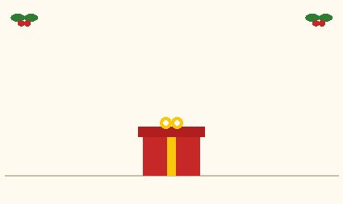
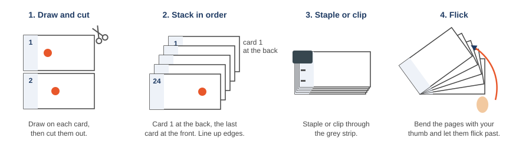

=========================================
Christmas flip books
=========================================

A **flip book** is a little book with a slightly different drawing on every page.
Flick the pages quickly and the drawing moves. Each page is one **frame**, just
like the frames in an animated GIF.

In this activity you will put together two Christmas flip books, then draw your
own on a template with guide lines to help you.

.. admonition:: You need

   * The PDFs below, printed on thin card at 100% (actual size)
   * Scissors, and a stapler or bulldog clip
   * A pencil, eraser and coloured pencils for your own flip book

----

Example 1: Santa's sleigh
-------------------------

:download:`christmas_flipbook_sleigh.pdf <flipbook/christmas_flipbook_sleigh.pdf>`
(24 cards on 2 pages)

   Santa's sleigh: 24 pages, played at 12 pages a second.

**Things to notice:**

* The sky, moon, stars and snowy hills are **exactly the same** on every card.
  Only the sleigh moves, so your eye follows it.
* The sleigh flies along a **curve** (an arc), not a straight line. It looks more
  natural.
* The reindeer's legs swap position on every card, so it looks like it is
  galloping.

Example 2: The present
----------------------

:download:`christmas_flipbook_present.pdf <flipbook/christmas_flipbook_present.pdf>`
(24 cards on 2 pages)

   The present: 24 pages, played at 12 pages a second.

**Things to notice:**

* For the first few cards **nothing happens**. A pause makes the surprise better.
* The present **shakes**, then **squashes down** before the lid pops. This is
  **anticipation**: a small movement that gets you ready for the big one.
* The star rises fast at first, then **slows down** as it reaches the top.
* At the end, the sparkles switch between two shapes on every card, so the star
  **twinkles**.

----

Putting a flip book together
----------------------------

   Making a flip book from the printed cards.

#. **Cut** out the cards along the solid lines.
#. **Stack** them in number order with **card 1 at the back** and card 24 at the
   front. Tap the stack on the desk so the left edges line up.
#. **Staple** or bulldog-clip through the pink strip, about 1 cm from the left
   edge.
#. **Flick** from the back to the front: hold the strip in one hand, bend the
   pages up with the thumb of your other hand, then let them flick past. If it
   plays backwards, flick the other way.

----

Make your own
-------------

:download:`christmas_flipbook_template.pdf <flipbook/christmas_flipbook_template.pdf>`
(24 blank cards on 2 pages)

Each card in the template has **guide lines** to help you draw:

.. list-table::
   :header-rows: 1
   :widths: 25 75

   * - Guide
     - How to use it
   * - **Ground line**
     - Things standing on the ground (a snowman, a present, an elf's feet) sit on
       this line on every card, so they don't float up and down by accident.
   * - **Dot grid**
     - The dots are 5 mm apart. Use them to measure how far something moves. For
       example, move the sleigh **one dot** to the right on every card. Move it
       **half a dot** to make it slow down.
   * - **Centre mark** (+)
     - Helps you put things in the same place on every card, such as a tree or a
       chimney in the middle of the scene.

Steps
~~~~~

#. **Plan.** Choose one simple Christmas action. Write down what happens at the
   start, the middle and the end.
#. **Draw the key poses** in pencil: card 1 (start), card 12 (middle) and
   card 24 (end).
#. **Draw the in-betweens.** Do card 6 (first in-between), then card 17 (second in-between).
   Then do card 3, card 9, card 15 and card 21. Then do the rest. This is called **in-betweening**.
#. **Test it.** Clip the cards together and flick. Fix any jumps.
#. **Finish** in pen and colour. Keep the colours the same on every card.

.. tip::

   Keep it simple: **one** thing moving is plenty. Small steps between cards give
   smooth movement. Big steps make the picture jump.

Christmas ideas
~~~~~~~~~~~~~~~

* A snowman being built, one snowball at a time
* A Christmas tree's lights switching on, one by one
* A snowflake drifting down and landing on a nose
* A star shooting across the sky
* A gingerbread person running away
* An elf throwing a snowball
* Santa sliding down a chimney
* A candle being lit and the flame flickering

.. admonition:: Think about it

   * How many cards did your flip book use? How long did it last when you flicked
     it?
   * Which parts stayed still? Why does that matter?
   * Did you use anticipation, an arc or slowing down? Where?

